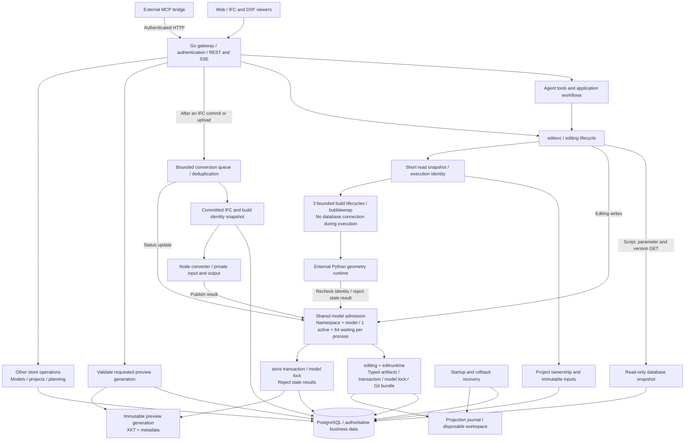
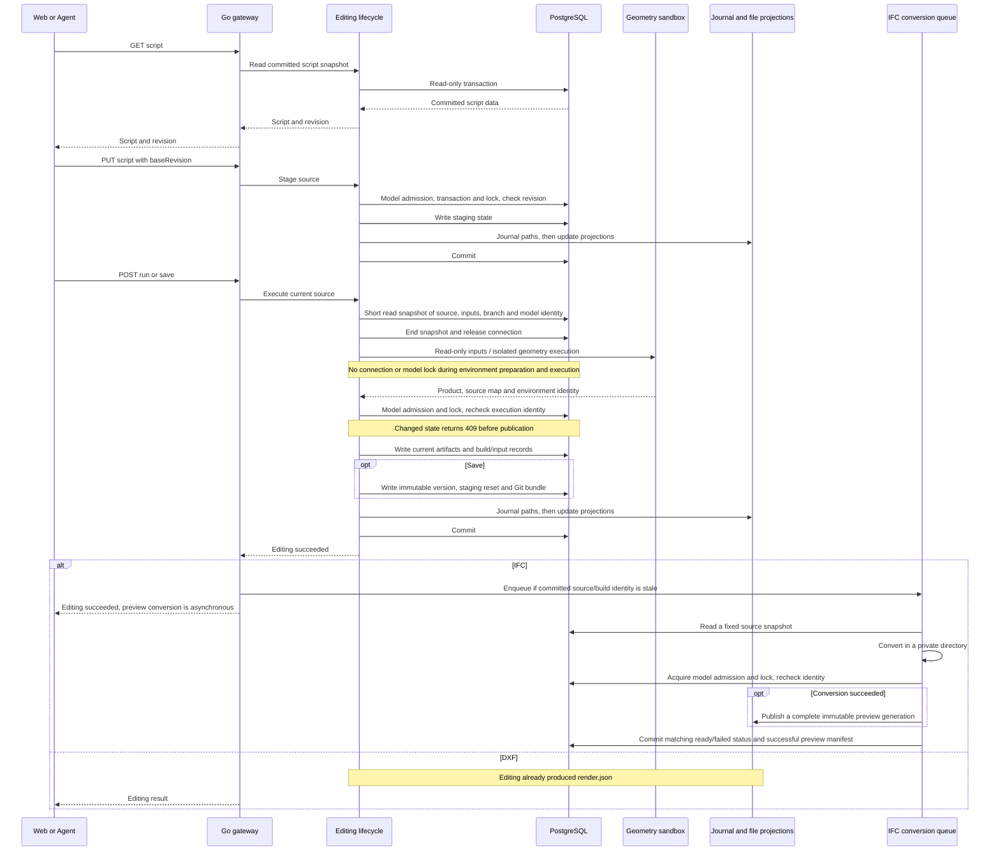

# SourceAEC

[中文](README.zh-CN.md)

An open-source, self-hosted, agent-friendly interface for IFC operations.
SourceAEC exposes IFC authoring, editing, inspection, sandboxed execution, and
semantic version history through the same script-as-source APIs for agents and
people. An optional planning and DXF workflow can feed the IFC authoring path.

> Documentation: <https://0702hjj.github.io/SourceAEC/>

See [engine and integration boundaries](docs/site/development/integration-boundaries.md)
for the responsibilities of SourceAEC domain services and external CAD engines.

## Highlights

- A Go business runtime for editing, staging, sandbox orchestration, persistence,
  versions, Git, planning delivery and MCP.
- Shared script-as-source REST APIs for humans and agents.
- External IfcOpenShell/ezdxf geometry runtimes and optional external CAD SDKs.
- Python model source exists only as runtime data; no maintained Python
  application, SDK, CLI, hook or test source is shipped in this repository.
- React frontend, IFC viewer/converter, and DXF browser rendering.
- PostgreSQL persistence and immutable script/product versions.

## Architecture



Editing writes, conversion publication and status updates share admission before
acquiring database connections. PostgreSQL locks provide cross-process exclusion.
Geometry preparation and execution release the database connection and model lock.
Publication rejects changed source, inputs or branches with 409. Process budgets
do not provide a shared resource limit across replicas.

## Main Data Flow



`run` updates the current product without creating a version. `save` executes
the source again and creates an immutable version. `rollback` re-executes saved
source with archived inputs. IFC model commit and preview conversion are separate
completion points; stale conversion results cannot replace the current preview.

## Quick Start

Requirements: Go 1.27.3+, PostgreSQL, Git, Linux bubblewrap and util-linux
`prlimit`. Node.js 22 is needed for the converter/frontend. Install uv for
Go-managed Python 3.12 geometry environments, or set `SOURCEAEC_PYTHON` to an
absolute interpreter path with the required geometry packages installed.

```bash
export VIEWER_PG_DSN='postgres://localhost/sourceaec'
cd converter && npm ci
cd ../web && npm ci && npm run build
cd ../server && go run ./cmd/server
```

The gateway owns all business operations in-process. Configure paths and the
shared data directory in `server/server_config.json` (copy the example first).
For a Vite development frontend, run `npm run dev` from `web` separately.
Set `VIEWER_API_TOKEN` and `VIEWER_CORS_ORIGINS` before exposing the gateway.
Missing bubblewrap fails closed; there is no production fallback backend.

Build Linux server archives with `scripts/build_server_release.sh VERSION`.
They include the gateway, Go runtime and Go stdio MCP bridge; geometry packages,
frontend assets and converter dependencies remain separate deployment inputs.
Run the MCP bridge with `SOURCEAEC_API_URL` and `VIEWER_API_TOKEN` configured.

## Repository Layout

| Path | Responsibility |
| --- | --- |
| `server/cmd/server` | Gateway startup, configuration, dependency wiring and lifecycle |
| `server/cmd/sourceaec-mcp` | External stdio MCP entry point; calls the authenticated gateway |
| `server/cmd/edit-runtime` | Private stdio adapter for storage and version operations |
| `server/cmd/loadgen` | HTTP/SSE, read and upload load tools |
| `server/cmd/migrate-sqlite` | Offline migration of legacy SQLite data |
| `server/internal/api` | REST, authentication, response envelopes, chat and SSE adapters |
| `server/internal/agent` | Agent workflows, tools, approvals, skills and file-access boundaries |
| `server/internal/editsvc` | In-process editing client and HTTP compatibility adapter |
| `server/internal/editing` | Shared IFC/DXF staging, execution, comparison, save, rollback and format adapters |
| `server/internal/editruntime` | Transactions, durable versions, typed artifacts, Git bundles, input snapshots and private protocol dispatch |
| `server/internal/artifact` | PostgreSQL artifacts, namespaces, model admission, projection journals and recovery |
| `server/internal/store` | Models, projects, planning data, status and conditional preview publication |
| `server/internal/change`, `server/internal/issue`, `server/internal/override` | Provenance, review issues and property overrides |
| `server/internal/convert` | Bounded IFC conversion queue, source snapshots, stale-result handling and Node adapter |
| `server/internal/metrics` | Request, queue, admission and execution observability |
| `server/internal/mcpbridge` | MCP tools routed through the authenticated gateway |
| `server/internal/migration`, `server/internal/reviewmigration` | Legacy data migration and verification |
| `server/internal/releasepackage` | Server distribution and packaging checks |
| `web/src/api` | Browser request clients and API contracts |
| `web/src/pages`, `web/src/components` | Pages, chat and model-operation UI |
| `web/src/ifcviewer`, `web/src/dxfviewer`, `web/src/viewer` | IFC/DXF rendering and viewer interaction adapters |
| `converter/convert.js`, `converter/lib` | IFC-to-XKT and metadata conversion |
| `converter/test` | Converter tests and synthetic geometry fixtures |
| `skills/sourceaec` | Integration declarations, optional format references and license notices |
| `examples` | Public example inputs and model source |
| `docs/site` | Public VitePress documentation; `docs` also holds its build configuration |
| `scripts` | Builds, releases, smoke/integration checks and repository boundaries |
| `.github/workflows` | Pull-request verification and manual workflows |

`data/`, build output, dependency directories and caches are runtime/generated
state, not maintained source. Retired service directories are not online runtime
components. Python geometry libraries remain external dependencies.

## Development

```bash
cd server && go test ./... && go vet ./...
cd web && npm test && npm run lint && npm run build
cd converter && npm test
cd docs && npm run docs:build
```

Use a dedicated PostgreSQL database for `VIEWER_PG_DSN` and
`VIEWER_TEST_PG_DSN` when running Go integration tests. Run repository checks
from its root:

```bash
scripts/check_file_size.sh
scripts/check_public_snapshot.sh
scripts/check_go_business.sh
```

See [CONTRIBUTING.md](CONTRIBUTING.md) and the
[documentation](https://0702hjj.github.io/SourceAEC/) for details.

## Use And Warranty Boundary

SourceAEC is a developer tool and reference implementation, not a safety-
critical, regulatory, surveying, or construction approval system. Generated
IFC/DXF content, AI suggestions, conversions, and sandbox results require
independent human review before they are used in design, procurement,
construction, operation, or compliance decisions. The project does not make
any promise that an output is accurate, fit for a particular purpose,
interoperable with every downstream tool, compliant with a law or standard,
or free of third-party rights claims. The Apache-2.0 license and the notices
for bundled dependencies govern the applicable warranty and liability terms.

## License

SourceAEC-authored material is licensed under Apache-2.0. The consolidated
`skills/sourceaec` bundle preserves MIT notices for adapted material from the
retired planning/DXF skills in its `licenses/` directory. Third-party runtime components
are described in [NOTICE](NOTICE). The IFC web experience has separate xeokit
and web-ifc viewer paths. The current standard web build includes both, so
selecting web-ifc at runtime does not remove xeokit or its AGPL-3.0 obligations
from that build. The tracked web-ifc WASM files remain subject to MPL-2.0.
