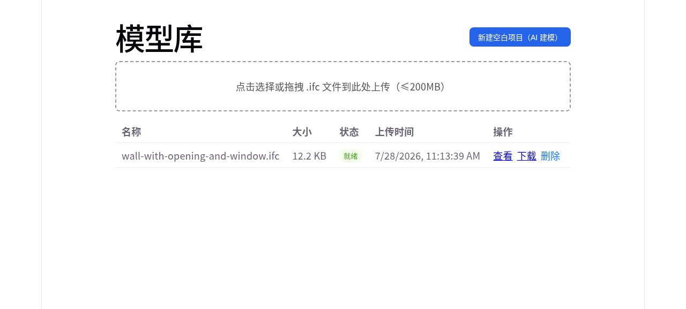
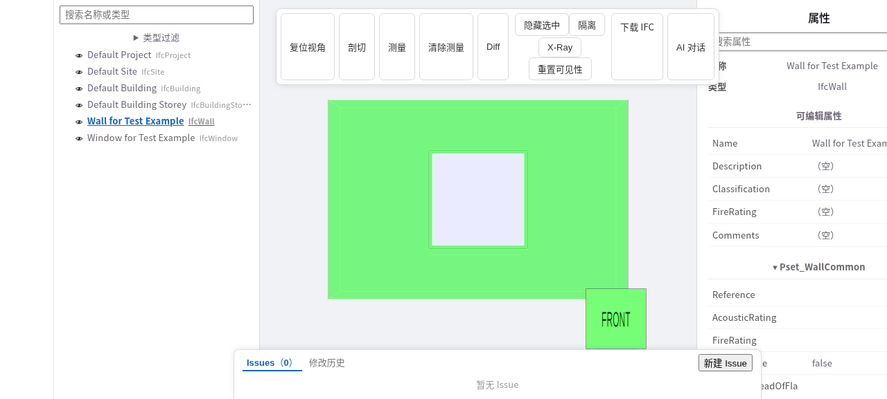
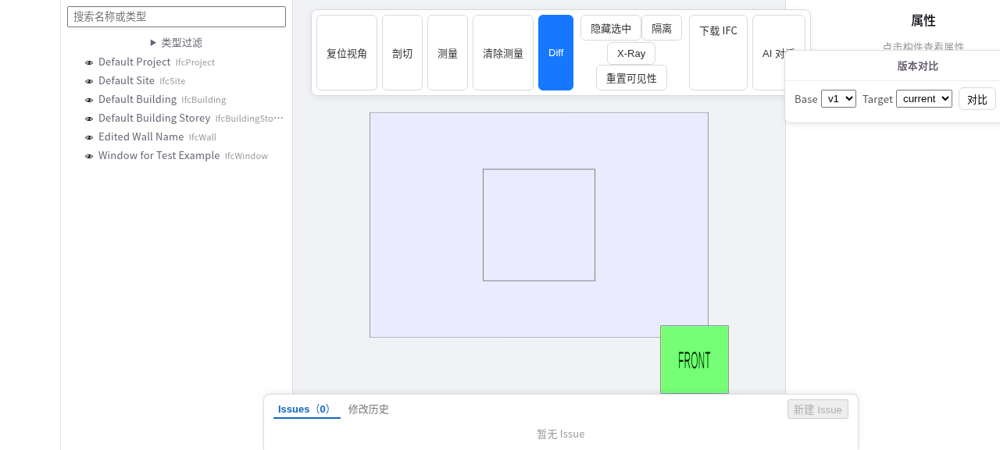
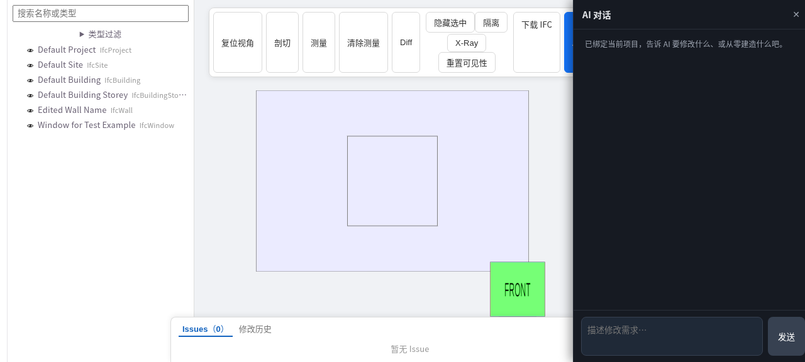

# SourceAEC

[中文](README.zh-CN.md)

An open-source, self-hosted, agent-friendly interface for IFC operations.
SourceAEC exposes IFC authoring, editing, inspection, sandboxed execution, and
semantic version history through the same script-as-source APIs for agents and
people. An optional planning and DXF workflow can feed the IFC authoring path.

> Documentation: <https://0702hjj.github.io/SourceAEC/>

SourceAEC 的领域服务与通用 CAD 引擎之间的职责边界见[引擎与集成边界](docs/site/development/integration-boundaries.md)。

## Highlights

- A Go business runtime for editing, staging, sandbox orchestration, persistence,
  versions, Git, planning delivery and MCP.
- Shared script-as-source REST APIs for humans and agents.
- External IfcOpenShell/ezdxf geometry runtimes and optional external CAD SDKs.
- Python model source exists only as runtime data; no maintained Python
  application, SDK, CLI, hook or test source is shipped in this repository.
- React frontend, IFC viewer/converter, and DXF browser rendering.
- PostgreSQL persistence and immutable script/product versions.

## Architecture

```text
Browser / Agent / Go MCP bridge
                 |
                 v
Go gateway :8090 (editing + sandbox orchestration + agent)
        |             |                  |
   PostgreSQL      converter       bubblewrap sandbox
                                   generated model source
                                   external geometry runtime
```

## Screenshots

| Model library | IFC properties |
|---|---|
|  |  |

| Version diff | AI chat |
|---|---|
|  |  |

## Quick Start

Requirements: Go 1.27.3+, PostgreSQL, Git, Linux bubblewrap and util-linux
`prlimit`. Node.js 22 is needed for the converter/frontend. Install uv for
Go-managed Python 3.12 geometry environments, or set `SOURCEAEC_PYTHON` to an
absolute interpreter path with the required geometry packages installed.

```bash
export VIEWER_PG_DSN='postgres://localhost/sourceaec'
cd converter && npm ci
cd ../web && npm ci && npm run build
cd ../server && go run ./cmd/server
```

The gateway owns all business operations in-process. Configure paths and the
shared data directory in `server/server_config.json` (copy the example first).
For a Vite development frontend, run `npm run dev` from `web` separately.
Set `VIEWER_API_TOKEN` and `VIEWER_CORS_ORIGINS` before exposing the gateway.
Missing bubblewrap fails closed; there is no production fallback backend.

Build Linux server archives with `scripts/build_server_release.sh VERSION`.
They include the gateway, Go runtime and Go stdio MCP bridge; geometry packages,
frontend assets and converter dependencies remain separate deployment inputs.
Run the MCP bridge with `SOURCEAEC_API_URL` and `VIEWER_API_TOKEN` configured.

## Repository Layout

```text
server/       Go gateway, editing domain, sandbox runner, agent and MCP bridge
web/          React frontend
converter/    IFC-to-XKT conversion
skills/       one SourceAEC integration skill with optional IFC/DXF references
scripts/      shell build and boundary checks
docs/         public VitePress documentation
```

## Development

```bash
cd server && go test ./... && go vet ./...
cd web && npm test && npm run lint && npm run build
cd converter && npm test
cd docs && npm run docs:build
```

Use a dedicated PostgreSQL database for `VIEWER_PG_DSN` and
`VIEWER_TEST_PG_DSN` when running Go integration tests. Run repository checks
from its root:

```bash
scripts/check_file_size.sh
scripts/check_public_snapshot.sh
scripts/check_go_business.sh
```

See [CONTRIBUTING.md](CONTRIBUTING.md) and the
[documentation](https://0702hjj.github.io/SourceAEC/) for details.

## Development Provenance

SourceAEC is an independent implementation informed by the public SimpleCADAPI
project and its related research published in *Computer-Aided Design*, public
IFC standards, documented open-source interfaces, and other public technical
literature. No private or confidential third-party repository, source code,
internal document, customer data, drawing, or other non-public technical
material was intentionally used as an implementation input or copied into this
project. The public Git history begins with an initial source snapshot;
subsequent development is recorded through commits and pull requests.

The project was independently undertaken outside the duties specified in the
maintainer's internship agreement and was not developed to perform an
internship work assignment. It did not use the internship organization's
material or technical resources and was implemented from public materials
using personally funded resources.

Contributions must have a documented, lawful provenance. Contributors certify
their right to submit each contribution, disclose incorporated third-party
material and its license, and must not submit confidential information or
trade secrets. See [CONTRIBUTING.md](CONTRIBUTING.md) for the DCO sign-off and
provenance requirements. If you believe material in this repository infringes
your rights, please open an Issue with the affected path and the basis of your
claim so it can be investigated promptly. Do not disclose confidential
materials or personal data in a public Issue; use a private GitHub security
report or private maintainer contact when available.

The project's independent origin, development record, rights position, and
third-party licensing boundaries are described in
[PROJECT_PROVENANCE.md](PROJECT_PROVENANCE.md).

## Use And Warranty Boundary

SourceAEC is a developer tool and reference implementation, not a safety-
critical, regulatory, surveying, or construction approval system. Generated
IFC/DXF content, AI suggestions, conversions, and sandbox results require
independent human review before they are used in design, procurement,
construction, operation, or compliance decisions. The project does not make
any promise that an output is accurate, fit for a particular purpose,
interoperable with every downstream tool, compliant with a law or standard,
or free of third-party rights claims. The Apache-2.0 license and the notices
for bundled dependencies govern the applicable warranty and liability terms.

## License

SourceAEC-authored material is licensed under Apache-2.0. The consolidated
`skills/sourceaec` bundle preserves MIT notices for adapted material from the
retired planning/DXF skills in its `licenses/` directory. Third-party runtime components
are described in [NOTICE](NOTICE). The IFC web experience has separate xeokit
and web-ifc viewer paths. The current standard web build includes both, so
selecting web-ifc at runtime does not remove xeokit or its AGPL-3.0 obligations
from that build. The tracked web-ifc WASM files remain subject to MPL-2.0.
