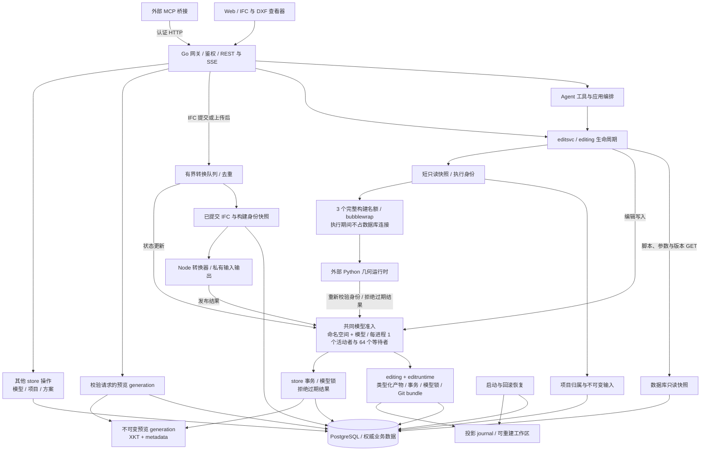
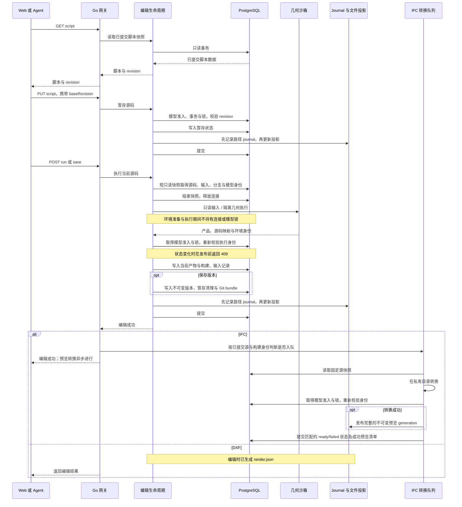

# SourceAEC

[English](README.md)

SourceAEC 是开源、自托管、面向 Agent 的 IFC 操作接口，支持可选的方案与 DXF 工作流。业务代码全部使用
Go：编辑 API、暂存、校验、沙箱编排、持久化、Git、版本、方案交付和 MCP。

Python 仅作为外部几何运行时。模型源码由用户或 Agent 生成，在沙箱中执行；
仓库不维护 Python 应用、SDK、CLI、hooks 或测试。skill 只保留必要的声明和参考，
不捆绑上游 SDK。IfcOpenShell、ezdxf、SimpleCADAPI 等属于外部运行能力。

领域服务与外部 CAD 引擎的职责见[引擎与集成边界](docs/site/development/integration-boundaries.md)。

## 架构



编辑写入、转换发布和状态更新共用数据库连接前的模型准入，PostgreSQL 模型锁
继续保证跨进程互斥。环境准备与几何执行期间释放数据库连接和模型锁；发布时发现
源码、输入或分支已变化则返回 409。进程内预算不代表跨副本共享资源上限。

## 主要数据链路



`run` 更新当前产品但不创建版本；`save` 再次执行源码并保存不可变版本；
`rollback` 使用归档输入重新执行旧源码。IFC 模型提交与预览转换是两个完成点，
过期转换结果不能替换当前预览。

## 启动

需要 Go 1.27.3+、PostgreSQL、Git、Linux bubblewrap 和 `prlimit`。
前端与转换器需要 Node.js 22。通过 uv 准备 Python 3.12 几何环境，或用
`SOURCEAEC_PYTHON` 指定已安装所需依赖的解释器绝对路径。

```bash
export VIEWER_PG_DSN='postgres://localhost/sourceaec'
cd converter && npm ci
cd ../web && npm ci && npm run build
cd ../server && go run ./cmd/server
```

可复制 `server/server_config.example.json` 为 `server/server_config.json` 配置路径。
网关在进程内处理业务，不需要启动 Python HTTP 服务。对外部署需配置
`VIEWER_API_TOKEN` 和 `VIEWER_CORS_ORIGINS`；缺少 bubblewrap 时拒绝执行脚本。

编辑仍走 stage → run → save。读取当前脚本后携带 `baseRevision` 暂存修改，
试运行成功并检查真实产物后再保存。方案交付只校验并版本化声明性数据，
不包含旧规划 CLI 的自动设计或合规判断。

## 仓库目录与职责

| 路径 | 职责 |
| --- | --- |
| `server/cmd/server` | 网关启动、配置、依赖装配与生命周期 |
| `server/cmd/sourceaec-mcp` | 外部 stdio MCP 入口，通过认证网关调用业务 |
| `server/cmd/edit-runtime` | 存储与版本操作的私有 stdio 协议适配 |
| `server/cmd/loadgen` | HTTP/SSE、读取与上传负载工具 |
| `server/cmd/migrate-sqlite` | 历史 SQLite 数据的离线迁移 |
| `server/internal/api` | REST、鉴权、响应 envelope、聊天与 SSE 适配 |
| `server/internal/agent` | Agent 编排、工具、审批、技能与文件访问边界 |
| `server/internal/editsvc` | 进程内编辑客户端与 HTTP 兼容适配 |
| `server/internal/editing` | IFC/DXF 共用的暂存、执行、比较、保存、回滚及格式适配 |
| `server/internal/editruntime` | 事务、持久版本、类型化产物、Git bundle、输入快照与私有协议分派 |
| `server/internal/artifact` | PostgreSQL 产物、命名空间、模型准入、投影 journal 与恢复 |
| `server/internal/store` | 模型、项目、方案数据、状态与条件预览发布 |
| `server/internal/change`, `server/internal/issue`, `server/internal/override` | 来源记录、审阅问题与属性覆盖 |
| `server/internal/convert` | 有界 IFC 转换队列、源快照、过期结果处理与 Node 适配 |
| `server/internal/metrics` | 请求、队列、准入与执行观测 |
| `server/internal/mcpbridge` | MCP 工具到认证网关的桥接 |
| `server/internal/migration`, `server/internal/reviewmigration` | 历史数据迁移与验证 |
| `server/internal/releasepackage` | 服务端分发与打包约束检查 |
| `web/src/api` | 浏览器请求封装与 API 契约 |
| `web/src/pages`, `web/src/components` | 页面、聊天与模型操作界面 |
| `web/src/ifcviewer`, `web/src/dxfviewer`, `web/src/viewer` | IFC/DXF 渲染与查看交互适配 |
| `converter/convert.js`, `converter/lib` | IFC 到 XKT 与 metadata 的转换 |
| `converter/test` | 转换测试与合成几何样例 |
| `skills/sourceaec` | 集成声明、可选格式参考与许可证通知 |
| `examples` | 可公开的示例输入与模型源码 |
| `docs/site` | 公共 VitePress 文档；`docs` 同时保存构建配置 |
| `scripts` | 构建、发行、smoke/集成验证与仓库边界检查 |
| `.github/workflows` | PR 验证与手动工作流 |

`data/`、构建输出、依赖目录和缓存属于运行或生成状态，不是维护源码。
已退役的服务目录不属于在线业务组件；Python 几何库保留为外部依赖。

## 验证

```bash
cd server && go test ./... && go vet ./...
cd web && npm test && npm run lint && npm run build
cd converter && npm test
cd docs && npm run docs:build
```

Go 集成测试使用独立 PostgreSQL 数据库，配置 `VIEWER_PG_DSN` 和
`VIEWER_TEST_PG_DSN`。根目录执行 `scripts/check_file_size.sh`、
`scripts/check_public_snapshot.sh` 和 `scripts/check_go_business.sh`。

发布包用 `scripts/build_server_release.sh VERSION` 构建，包含 Go 网关、业务运行时和
Go MCP 桥。前端、转换器和几何依赖单独安装。MCP 通过 `SOURCEAEC_API_URL` 与
`VIEWER_API_TOKEN` 访问 Go 网关。

文档：<https://0702hjj.github.io/SourceAEC/>。贡献与授权要求见
[CONTRIBUTING.md](CONTRIBUTING.md)，许可证与依赖声明见 [NOTICE](NOTICE)。

## 使用边界与保证

SourceAEC 是开发者工具和参考实现，不是安全关键、法定审查、测绘或施工审批系统。
生成的 IFC/DXF 内容、AI 建议、转换结果和沙箱结果，在用于设计、采购、施工、运行
或合规决定前，必须由具备相应资质的人员独立复核。本项目不承诺输出准确、适用于某
一特定用途、能够与所有下游工具互操作、符合任何法律或标准，或不涉及第三方权利
主张。适用的保证和责任边界以 Apache-2.0 许可证及所含依赖的许可证/声明为准。

## 许可证

SourceAEC 自有材料采用 Apache-2.0。合并后的 `skills/sourceaec` 在 `licenses/` 中
保留源自旧规划与 DXF skill 材料的 MIT 声明。第三方运行时见 [NOTICE](NOTICE)。
IFC Web 体验包含相互独立的 xeokit 与 web-ifc 查看路径，但当前标准 Web 构建同时
包含两者；运行时切换到 web-ifc 并不会从该构建中移除 xeokit，也不会自动消除其
AGPL-3.0 义务。仓库内的 web-ifc WASM 文件仍受 MPL-2.0 约束。
