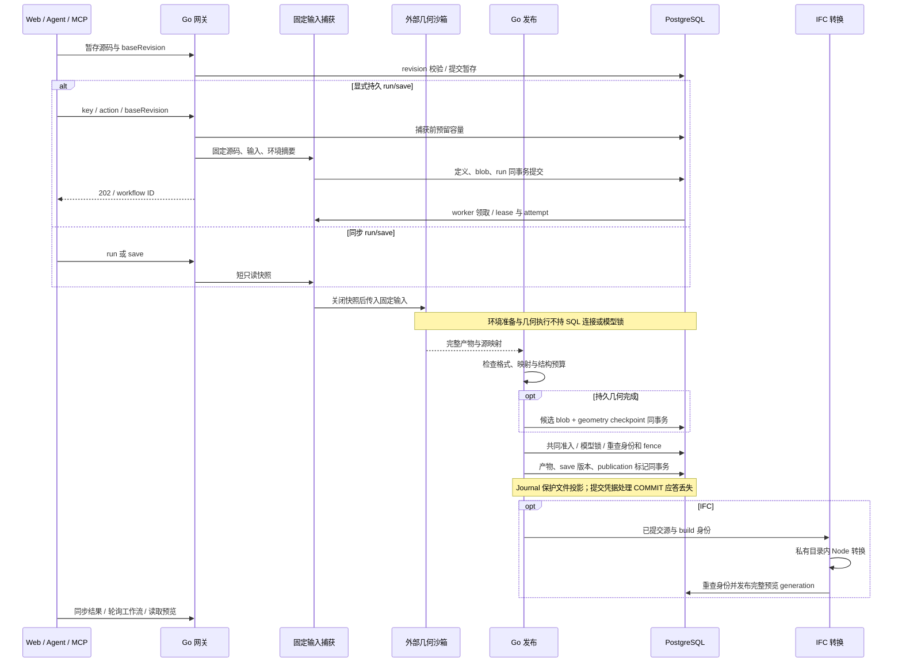
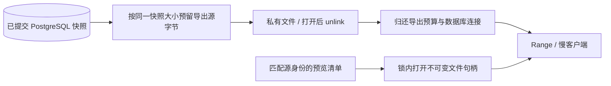

# 数据流与事务

下图区分输入快照、外部执行、原子发布和派生转换。节点 ID 与[架构总览](/architecture/overview)一致。

窄屏上可横向滚动图表，避免将整张架构图缩小到难以阅读。

## 三种完成点

- `run` 发布当前产物，不创建版本；`save` 执行并保存不可变版本。
- 持久 API 的 202 表示固定定义已接受，不代表几何、版本或预览已完成。
- IFC 模型提交与预览转换分别完成。转换恢复不会再次保存版本；DXF 由 Go 直接生成 render 数据。

## 读取路径

导出源字节预算在导出结束归还；快照文件名额随客户端读取释放。
这些额度不是 PG 内存、临时空间或整个系统 RSS 的硬上限。
详见[预览与读取](/architecture/previews)和[资源验证](/operations/performance)。
