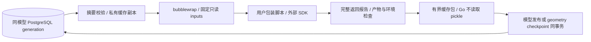

# 可选 Notebook 缓存

模型包装脚本可调用外部 SimpleCADAPI notebook，并自行导出 IFC 或 ASCII DXF。
SourceAEC 不增加产品格式、不复制 SDK，也不保存 Python 内存栈或逐 cell 崩溃检查点。
当前适配经过 SimpleCADAPI `2.2.0b1` 验证；SDK 仍是管理员安装的外部几何依赖。

## 显式声明

在模型包装脚本的 PEP 723 头部声明：

```toml
# 放入 # /// script ... # /// 注释块内，各行加 # 前缀。
[tool.sourceaec.notebook]
adapter = "simplecadapi-v1"
notebooks = ["skill-work/project/part.py"]
reuse = "declared"
```

最多声明 16 个项目输入 `.py` 文件。路径必须与捕获输入中的相对路径完全一致，
在沙箱中从 `/inputs/` 读取。包装脚本负责调用外部 SDK 并写入正常产品输出路径。
`reuse="declared"` 是作者对依赖与副作用可安全复用的显式声明；缺省或 `never` 不恢复/持久化缓存。
动态导入、时钟、随机数和未声明文件不能据此获得确定性保证；不能证明安全时使用 `never` 或 SDK `cache=False`。

## 隔离与数据流



只有声明 notebook 父目录下的 `__marimo__` 被挂载为本次尝试的私有可写目录。
不接受上传到这些保留路径的缓存；每次尝试各自复制，SDK 清理不会影响其他并发尝试。
缓存只在同数据库命名空间、同模型内恢复，不在模型之间共享 pickle。

缓存兼容身份包含包装脚本、环境内容摘要、管理员地址空间预算、适配版本和所有非 notebook 输入。
声明 notebook 的代码修改交由外部 SDK 根据代码/依赖/值决定失效；不能把 SDK cell key 当永久业务 ID。
模块或输入变化可以保守全部失效。环境或适配版本变化不会复用旧缓存。

## 完整完成报告

包装脚本在 SDK 完整返回后，将 JSON 写入 `SOURCEAEC_NOTEBOOK_REPORT`：

```json
{
  "version": 1,
  "notebooks": [{
    "path": "skill-work/project/part.py",
    "sha256": "<捕获 notebook 源字节的 64 位小写 SHA-256>",
    "definition": "sha256:<SDK definition.content_hash 的 64 位摘要>",
    "cells": [{"key": "<SDK cell key>", "status": "ran"}]
  }]
}
```

每个声明文件都需要一条报告。cell 状态为 `ran`、`cached` 或 `skipped`，总数最多 10000；
报告最多 1 MiB。Go 校验路径/源摘要/报告结构、产物、源映射及执行前后环境，再接受缓存。
`current.build.json` 和版本构建记录保存缓存状态、兼容/代际身份、报告摘要、cell 计数与 notebook definition 摘要。
`restored` 仅表示恢复了缓存包，实际命中数以 SDK 的 `cached` 计数为准；
`missing`、`incompatible`、`corrupt`、`unavailable` 或 `disabled` 解释冷执行原因。

报告是受校验的执行输出，不是工程合规或任意脚本副作用的认证。
损坏或缺失缓存执行完整脚本；不得跳过必需工作。

## 生命周期与资源

缓存包最多 64 MiB、4096 个普通文件、1 MiB 清单，并有遍历、路径、长度及逐文件摘要限制。
Go 不反序列化 pickle。包与当前引用在受模型锁/ownership fence 保护的事务中提交；
切换引用后清理未引用 generation。执行先物化私有副本，再归还 SQL 连接，不持连接运行 SDK。

同步 run/save 在产物发布事务接受缓存；持久工作流在 geometry checkpoint 事务接受缓存。
进程在检查点前中断，整个未完成脚本仍可能重做；检查点后的产品恢复沿用原工作流发布契约。
模型删除同时清理缓存。每模型保留当前 generation，不提供跨模型总磁盘或 PG RSS 配额。
三份完整构建名额仍共享；缓存包字节与 SDK 原生内存应计入容量规划。

默认地址空间仍为 1 GiB。管理员可设置 `SOURCEAEC_NOTEBOOK_AS_BYTES`（十进制字节，64 MiB–8 GiB），
仅对显式 notebook 执行生效；无效配置拒绝执行。该值是地址空间限制，不是 RSS 配额。
更改预算会使冻结环境身份改变，旧定义需要重新提交；客户端不能在请求中提高此上限。
SDK 的实际依赖可能需要更高预算，部署前应使用专用数据库执行 `scripts/test_notebook_integration.sh`，
提供 `SOURCEAEC_TEST_NOTEBOOK_PYTHON`；脚本验证发布的固定 SDK、真实冷/热/局部修改等价、并发与恢复。
