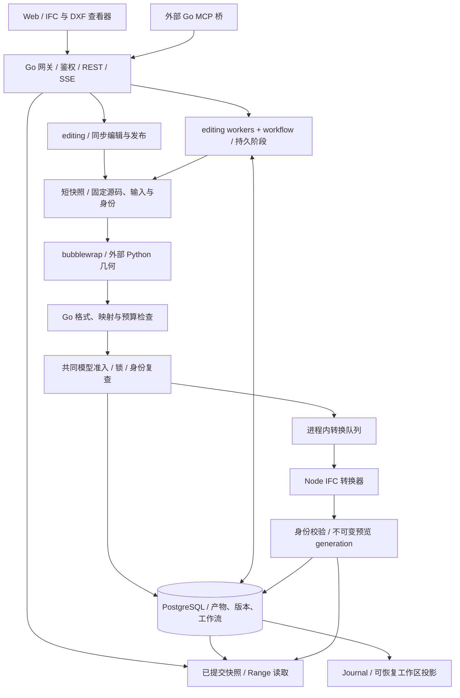

# 架构总览

SourceAEC 以 Go 网关为唯一业务入口。浏览器、内置 Agent 和外部 MCP 使用相同的编辑契约，
PostgreSQL 保存业务事实，外部 Python 只执行几何，Node 只做 IFC 显示格式转换。

窄屏上可横向滚动图表，避免将整张架构图缩小到难以阅读。

## 按职责阅读

| 层 | 实现 | 文档 |
| --- | --- | --- |
| 入口 | `api`、`agent`、`mcpbridge` | [网关](/architecture/gateway)、[Web](/architecture/web)、[接入](/integrations/overview) |
| 模型业务 | `editing`、`editruntime` | [编辑](/architecture/editing)、[数据流](/architecture/data-flow) |
| 可恢复任务 | `workflow` 与 editing worker | [并发与恢复](/architecture/execution)、[工作流 API](/reference/workflows) |
| 权威状态 | `artifact`、`versionstore`、`sourcepatch`、`store` | [存储与版本](/architecture/storage) |
| 外部执行 | bubblewrap、Python、Node | [沙箱](/architecture/sandbox)、[格式](/architecture/formats)、[预览](/architecture/previews) |

## 部署边界

当前契约为单个网关、同一数据库命名空间与共享工作区。进程内队列和名额不是跨副本全局配额。
环境准备、几何执行与慢客户端下载不长期持有数据库连接。
发布重新验证模型、源码、输入、分支身份；持久工作流还校验完整 ownership fence。

普通同步请求不自动续跑。显式工作流保存固定定义和已完成阶段；未完成几何可重复执行，
已提交版本不重复推进。不保存 Python 堆栈，不提供 notebook cell 级恢复。

文档对应仓库源码能力；部署时应使用匹配版本。外部 SDK 的能力不自动成为 SourceAEC 产品能力。
