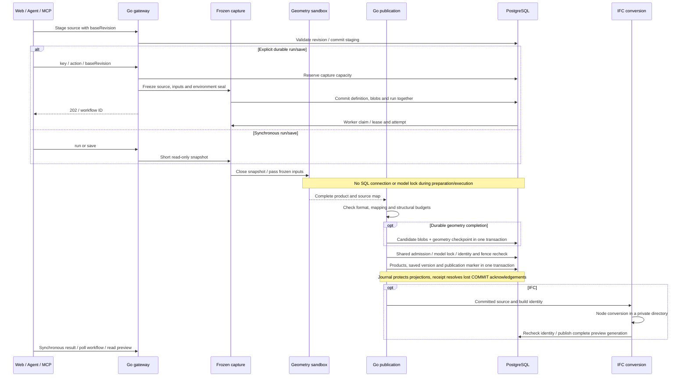
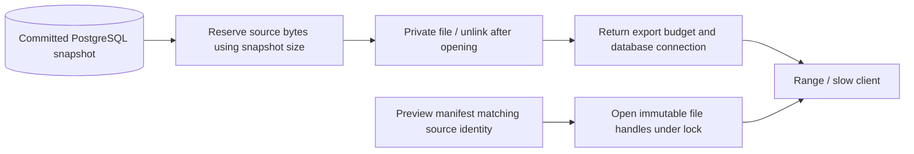

# Data flow and transactions

The diagram separates capture, external execution, atomic publication and derived conversion. Participant IDs match the
[architecture overview](/en/architecture/overview).

## Completion points

`run` publishes a product without a version; `save` executes and saves an immutable version.
A durable 202 confirms the frozen definition was accepted, not that geometry/publication/conversion completed.
IFC publication and preview conversion are separate. Conversion recovery does not save another version;
DXF render data is generated directly by Go.

## Read path

Export byte reservations end with export; file reservations remain until client reads finish.
Neither is a hard limit on PG memory/temp space or total system RSS.
See [previews](/en/architecture/previews) and [capacity verification](/en/operations/performance).
