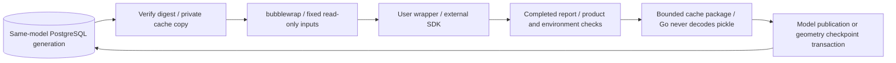

# Optional notebook cache

User-authored wrapper scripts can call external SimpleCADAPI notebooks and export IFC or ASCII DXF themselves.
This adapter adds no product format, bundled SDK, Python stack persistence or per-cell crash checkpoint.
The external SDK contract is verified with SimpleCADAPI `2.2.0b1`; administrators install the geometry dependency.

## Explicit declaration

Place this table in the wrapper's PEP 723 script comment block, prefixing every line with `#`:

```toml
[tool.sourceaec.notebook]
adapter = "simplecadapi-v1"
notebooks = ["skill-work/project/part.py"]
reuse = "declared"
```

Declare up to 16 project-input `.py` paths matching captured relative paths. Read them beneath `/inputs/` inside the sandbox.
The wrapper calls the SDK and writes the ordinary IFC/DXF output. `declared` explicitly asserts that reuse is safe for the author's
dependencies/side effects; the default or `never` does not restore/persist cache. Dynamic imports, clocks, random values and undeclared files
are not inferred deterministic. Use `never` or SDK `cache=False` where safety cannot be established.

## Isolation and data flow



Only `__marimo__` beneath declared notebook parent directories becomes privately writable for each attempt.
Uploaded cache state at those reserved paths is rejected. Each attempt gets its own copy, so SDK cleanup cannot delete another attempt's data.
Cache restore is scoped to the database namespace/model; pickle is never shared between models.

Compatibility includes wrapper source, environment contents, administrator address-space budget, adapter policy and all non-notebook inputs.
Declared notebook code edits use the external SDK's code/value/dependency invalidation. SDK cell keys are not permanent business IDs.
Module/input changes may conservatively invalidate the whole cache. Environment/adapter upgrades do not reuse old packages.

## Completion report

After the SDK returns completely, write JSON to `SOURCEAEC_NOTEBOOK_REPORT`:

```json
{
  "version": 1,
  "notebooks": [{
    "path": "skill-work/project/part.py",
    "sha256": "<64 lowercase hex SHA-256 of captured notebook bytes>",
    "definition": "sha256:<64 hex digest from SDK definition.content_hash>",
    "cells": [{"key": "<SDK cell key>", "status": "ran"}]
  }]
}
```

Every declared notebook needs a report. Statuses are `ran`, `cached` or `skipped`, limited to 10000 cells and a 1 MiB report.
Go checks source identities/report structure, product, source map and environment before accepting cache state.
`current.build.json` and version build records contain cache status, compatibility/generation identity, report digest,
cell counts and notebook definition identities. `restored` means the package was restored; SDK `cached` counts show actual cell hits.
`missing`, `incompatible`, `corrupt`, `unavailable` and `disabled` explain cold execution.

Reports are validated execution output, not design compliance or certification of arbitrary side effects.
Missing/corrupt caches rerun required work rather than skip it.

## Lifecycle and resources

Packages are limited to 64 MiB, 4096 regular files and a 1 MiB manifest, with bounded traversal/paths, sizes and per-file hashes.
Go never unpickles data. Generations/references commit under the existing model lock/ownership fence;
obsolete unreferenced generations are collected after reference replacement. Execution materializes its private copy and releases SQL first.

Synchronous run/save accepts cache in the product transaction; durable execution accepts it with the geometry checkpoint.
Loss before checkpoint can repeat the whole unfinished script. Later product recovery retains the original workflow publication rules.
Model deletion removes cache state. One current generation per model is retained; there is no global cross-model disk/PG RSS quota.
Three build lifecycles remain shared. Include package bytes and SDK native memory in capacity planning.

The default address space remains 1 GiB. Administrators may set `SOURCEAEC_NOTEBOOK_AS_BYTES` (decimal bytes, 64 MiB–8 GiB),
only for explicitly declared notebook execution. Invalid settings fail closed. This is address space, not an RSS quota.
Changing the budget changes frozen environment identity and requires a new definition; clients cannot raise it in requests.
SDK dependencies may require a larger budget. Validate deployment using a dedicated database and `scripts/test_notebook_integration.sh`
with `SOURCEAEC_TEST_NOTEBOOK_PYTHON`; it checks the pinned published SDK, real cold/hot/partial equivalence, concurrency and recovery.
