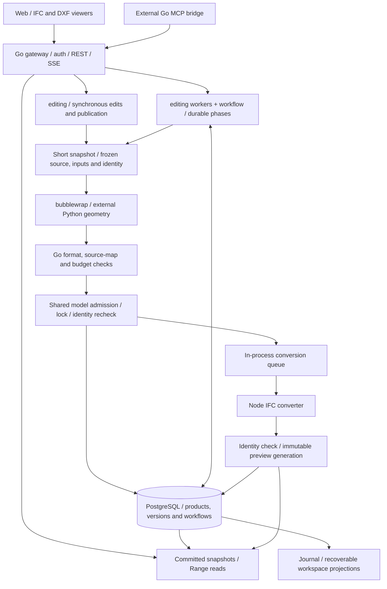

# Architecture overview

The Go gateway is the only business entry point. Browsers, the built-in agent and the external MCP bridge share editing contracts.
PostgreSQL stores authoritative state; external Python executes geometry and Node converts IFC display artifacts.

## Responsibility map

| Layer | Implementation | Read next |
| --- | --- | --- |
| Entry | `api`, `agent`, `mcpbridge` | [Gateway](/en/architecture/gateway), [Web](/en/architecture/web), [integration](/en/integrations/overview) |
| Model domain | `editing`, `editruntime` | [Editing](/en/architecture/editing), [data flow](/en/architecture/data-flow) |
| Durable work | `workflow` and editing workers | [Execution](/en/architecture/execution), [workflow API](/en/reference/workflows) |
| Authoritative state | `artifact`, `versionstore`, `sourcepatch`, `store` | [Storage](/en/architecture/storage) |
| External execution | bubblewrap, Python, Node | [Sandbox](/en/architecture/sandbox), [formats](/en/architecture/formats), [previews](/en/architecture/previews) |

## Deployment boundary

The supported contract is one gateway, a shared workspace and one database namespace. Process-local queues/budgets are not global
replica quotas. Environment preparation, geometry execution and slow downloads do not retain database connections for their duration.
Publication rechecks source/input/branch/model identity; durable publication also validates the complete ownership fence.

Synchronous requests do not automatically resume. Explicit workflows persist definitions and completed phases; unfinished geometry
may execute again, while committed versions do not advance twice. No Python stack or notebook cell recovery is provided.
Use documentation matching your deployed source revision; upstream SDK capabilities are not automatically SourceAEC capabilities.
