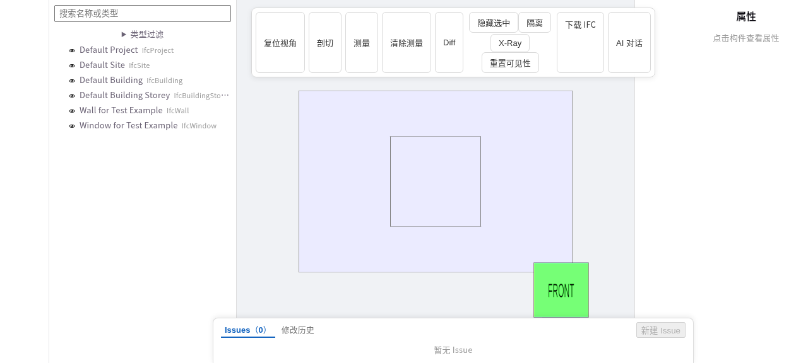

## Documentation map

Follow the system responsibilities, then choose an API or operational task.

| Section | Read about |
| --- | --- |
| [Start here](/en/guide/intro) | Understand the product and create/edit a project. |
| [Architecture](/en/architecture/overview) | Gateway, editing, execution, storage and preview boundaries. |
| [Operations](/en/operations/quickstart) | Startup, configuration, verification, capacity and hosting. |
| [Integrations](/en/integrations/overview) | Agents, MCP and declarative skills. |
| [API reference](/en/reference/rest-api) | REST, script edits, workflows, models and SSE. |

## Viewer

[LICENSE](https://github.com/0702hjj/SourceAEC/blob/main/LICENSE) · [NOTICE](https://github.com/0702hjj/SourceAEC/blob/main/NOTICE)
