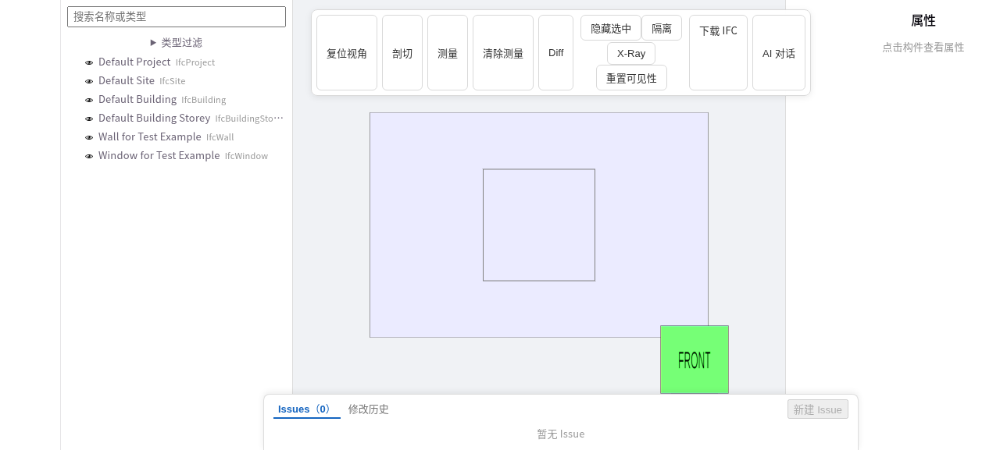

## 文档地图

先沿架构理解职责，再选择操作任务或 API 契约。

| 栏目 | 内容 |
| --- | --- |
| [入门](/guide/intro) | 了解产品、创建项目、编辑和审查。 |
| [架构](/architecture/overview) | 网关、编辑、执行、存储和预览职责。 |
| [运维](/operations/quickstart) | 启动、配置、验证、容量和文档托管。 |
| [接入](/integrations/overview) | Agent、MCP 与声明性 Skills。 |
| [API 参考](/reference/rest-api) | REST、脚本、工作流、模型及 SSE 契约。 |

## 查看器

[LICENSE](https://github.com/0702hjj/SourceAEC/blob/main/LICENSE) · [NOTICE](https://github.com/0702hjj/SourceAEC/blob/main/NOTICE)
